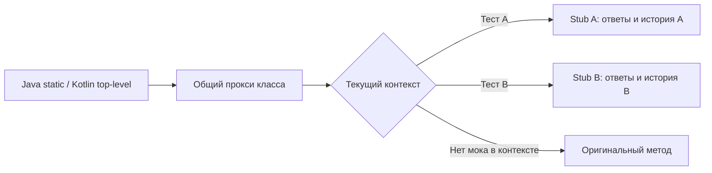

# Архитектура изоляции MockK

## Активация

`MockKIsolationExtension` регистрируется в META-INF/services/org.junit.jupiter.api.extension.Extension. Пользователь включает `junit.jupiter.extensions.autodetection.enabled=true`. Оригинальные `io.mockk.mockk`, стандартные аннотации MockK и `MockKExtension` сохраняются.

Extension запрашивает TEST_METHOD scope у JUnit 5.12.2 и открывает контекст в TestInstancePreConstructCallback. Поэтому в него попадают моки из конструктора, инициализаторов полей и post-processing стандартного MockKExtension. Контекст хранится в ExtensionContext.Store как CloseableResource; это обеспечивает очистку и при ошибке создания экземпляра. В afterEach он закрывается явно и идемпотентно.

## Адаптер MockK 1.14.6

Byte Buddy один раз атомарно переопределяет необходимые классы MockK; новый агент или gateway на каждый тест не создаётся. Перед установкой проверяются ключевые сигнатуры. Ошибка установки не скрывается. Версия MockK закреплена строгой зависимостью Gradle.

- Advice после StubRepository.add записывает владельца stub по идентичности, включая обычные, аннотированные и дочерние моки.
- Advice для allStubs возвращает только stubs текущего контекста. Оригинальные clearAllMocks, confirmVerified и checkUnnecessaryStub продолжают выполнять свои алгоритмы над ограниченным набором.
- MemberSubstitution заменяет чтение cache в MockKExtension кэшем текущего теста. Это устраняет смешивание зависимостей при параллельном constructor/parameter injection.
- Без активного контекста используются исходные registry и cache MockK.

Контекст активен в ThreadLocal. Реестр обычных stubs использует identity maps и синхронизацию. После вложенного запуска JUnit восстанавливается предыдущий контекст. При close() предпринимаются все операции очистки, ссылки освобождаются в finally; дополнительные ошибки добавляются как suppressed.

## Статические методы

Вызов JvmStaticMockFactory.staticMockk в активном контексте создаёт отдельный SpyKStub. Общий прокси устанавливается через стандартный MockK staticProxy; его handler выбирает stub текущего теста на каждом вызове. Scope хранит lookup по Class и StubRepository, а getAllStubs включает собственную статическую историю. Lookup original StubRepository.get перехватывается, чтобы стандартные clearStaticMockk и проверки типа мока видели текущий stub.

Счётчик общего прокси защищён монитором. Каждый тест удерживает свою ссылку на прокси класса; повторная регистрация и её отмена учитываются отдельно. Cancellation идемпотентен. unmockkStatic освобождает только свою ссылку; последняя снимает инструментацию через исходный cancel MockK. Handler не захватывает контекст конкретного теста.

MockKCancellationRegistry.subRegistry и cancelAll получают отдельные registries контекста. Это предотвращает отмену родительского или соседнего static-мока через unmockkAll и стандартный finish MockKExtension. Scope закрывает и забывает все оставшиеся отмены, даже без стандартного расширения или после ошибки конструктора.

## Границы

Общие object/constructor mocks отклоняются до глобальной модификации. PER_CLASS и TestFactory также отклоняются: их lifecycle не соответствует владению одним тестом. Перенос контекста между потоками не выполняется. Static mocks, созданные вне изоляции, нельзя смешивать с изолированными для одного класса. Нестандартная подмена MockKGateway и альтернативные версии MockK не являются поддерживаемой конфигурацией.

## Совместимость с v0.1.0

Прежний MockContext и функция com.grozniy.mockk остаются явным API. IsolatedMockKExtension обслуживает этот API. Новый автоматически обнаруживаемый MockKIsolationExtension — отдельный адаптер; стандартный пользовательский код MockK не зависит от старых обёрток.
