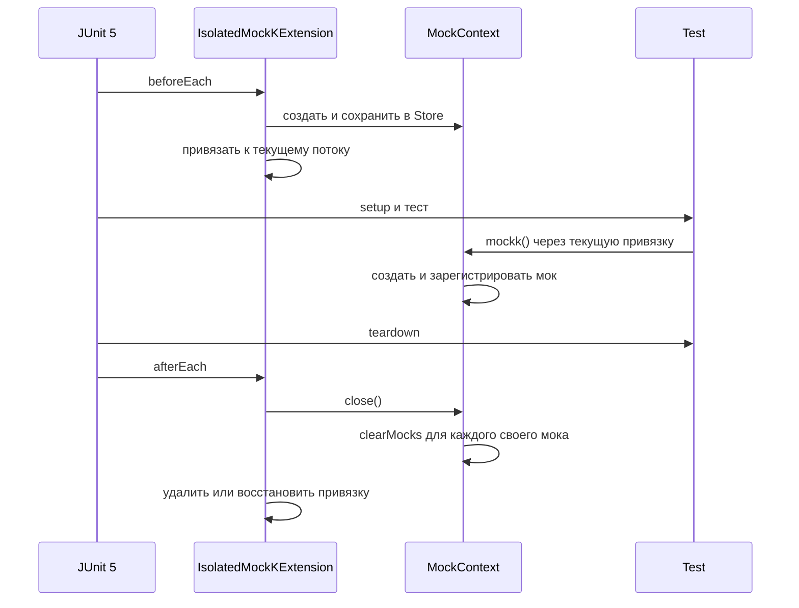

# Архитектура

## Жизненный цикл

Контекст принадлежит запуску теста в `ExtensionContext.Store`. `ThreadLocal` даёт функции `mockk()` доступ к нему без параметра; сам поток не является идентификатором теста. При повторном использовании потока новый тест получает новый контекст.

## Ответственность компонентов

- `Mocking.kt`: публичная функция `mockk<T>()` и внутренняя привязка текущего контекста. Без активного контекста функция выдаёт понятную ошибку.
- `MockContext`: создание, регистрация и очистка собственных моков. Монитор сериализует изменения реестра и закрытие. Мок регистрируется до блока настройки, поэтому исключение из блока не оставляет его вне очистки.
- `IsolatedMockKExtension`: lifecycle JUnit, хранение контекста и восстановление предыдущей привязки. ParameterResolver сохранён для совместимости с явным API.

## Ошибки и очистка

После начала close() контекст закрыт для создания новых моков. Повторное закрытие безопасно. Очистка пытается обработать все моки даже после первой ошибки и в finally удаляет собственные ссылки. Дополнительные ошибки добавляются как suppressed.

Расширение освобождает привязку в finally. Если тест уже упал, ошибка очистки добавляется к его ошибке; если тест был успешным, ошибка очистки делает его неуспешным.

## Границы решения

Изоляция достигается отдельными экземплярами моков и адресной очисткой. Проект не подменяет MockKGateway, не устанавливает собственный Java agent и не перехватывает оригинальную io.mockk.mockk. Поэтому нужен импорт com.grozniy.mockk.

Привязка доступна от beforeEach расширения до afterEach, включая пользовательские setup/teardown. Создание в конструкторе или инициализаторе поля происходит раньше и не поддерживается. Синхронизация реестра не даёт гарантий для одновременной настройки одного мока несколькими потоками.

Обычный ThreadLocal выбран под текущий контракт: один тест работает в одном потоке. Автоматическое наследование контекста дочерними потоками не используется, чтобы фоновые задачи не удерживали контекст завершённого теста. Для корутин и executor потребуется отдельный контракт передачи и времени жизни.

## Внешние источники

- [MockK](https://mockk.io/) — API моков и ограничения глобальной очистки.
- [JUnit 5.12.2](https://docs.junit.org/5.12.2/user-guide/) — extensions и параллельное выполнение.
- [Gradle setup action](https://github.com/gradle/actions/tree/v4/setup-gradle) — настройка Gradle в CI.
